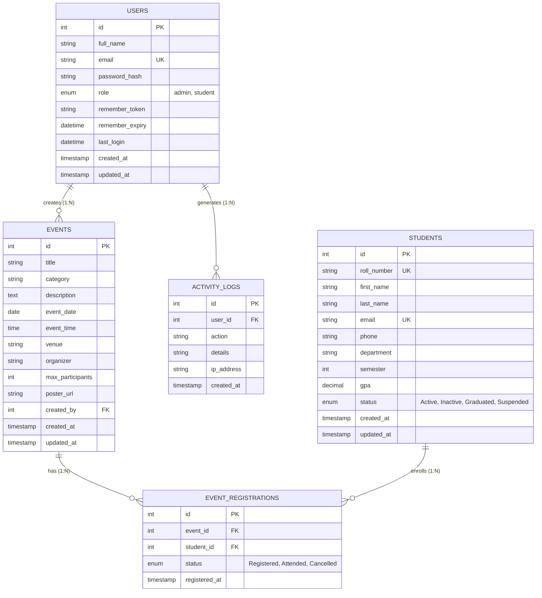

# Entity-Relationship (ER) Model & Database Architecture
**Campus Management & Event Portal — Milestone 8 Specification**

---

## 1. Visual Entity-Relationship Diagram (Mermaid)

---

## 2. Table Data Dictionary & Attribute Specifications

### A. `users` Table
Stores authenticated credentials, authorization roles, and Remember-Me tokens.
- **`id`**: `INT UNSIGNED AUTO_INCREMENT PRIMARY KEY`
- **`full_name`**: `VARCHAR(100) NOT NULL` — User's display name.
- **`email`**: `VARCHAR(150) NOT NULL UNIQUE` — Login identifier (Indexed).
- **`password_hash`**: `VARCHAR(255) NOT NULL` — Cryptographic hash computed via `password_hash($pass, PASSWORD_BCRYPT, ['cost' => 12])`.
- **`role`**: `ENUM('admin', 'student') NOT NULL DEFAULT 'student'` — RBAC privilege selector (Indexed).
- **`remember_token`**: `VARCHAR(64) DEFAULT NULL` — SHA-256 hash of random 32-byte selector.
- **`remember_expiry`**: `DATETIME DEFAULT NULL` — 30-day token expiration date.
- **`last_login`**: `DATETIME DEFAULT NULL` — Audit timestamp of latest successful sign-in.
- **`created_at`** / **`updated_at`**: Automatic timestamp management.

### B. `students` Table
Encapsulates university student academic records.
- **`id`**: `INT UNSIGNED AUTO_INCREMENT PRIMARY KEY`
- **`roll_number`**: `VARCHAR(30) NOT NULL UNIQUE` — Institutional roll number (Indexed).
- **`first_name`** / **`last_name`**: `VARCHAR(60) NOT NULL`.
- **`email`**: `VARCHAR(150) NOT NULL UNIQUE` — Institutional contact email.
- **`phone`**: `VARCHAR(20) NOT NULL`.
- **`department`**: `VARCHAR(80) NOT NULL` — Major discipline (Indexed for fast query filtering).
- **`semester`**: `TINYINT UNSIGNED NOT NULL DEFAULT 1` — Current semester standing (1–10).
- **`gpa`**: `DECIMAL(3, 2) NOT NULL DEFAULT 0.00` — Cumulative grade point average.
- **`status`**: `ENUM('Active', 'Inactive', 'Graduated', 'Suspended') NOT NULL DEFAULT 'Active'`.

### C. `events` Table
Tracks co-curricular symposia, hackathons, and workshops.
- **`id`**: `INT UNSIGNED AUTO_INCREMENT PRIMARY KEY`
- **`title`**: `VARCHAR(180) NOT NULL` — Event name.
- **`category`**: `VARCHAR(50) NOT NULL` (Indexed).
- **`description`**: `TEXT NOT NULL` — Complete event agenda.
- **`event_date`**: `DATE NOT NULL` (Indexed for chronological queries).
- **`event_time`**: `TIME NOT NULL`.
- **`venue`**: `VARCHAR(150) NOT NULL` — Campus hall or lab.
- **`organizer`**: `VARCHAR(100) NOT NULL` — Host club or department.
- **`max_participants`**: `INT UNSIGNED NOT NULL DEFAULT 100`.
- **`poster_url`**: `VARCHAR(255) DEFAULT NULL` — Server filesystem path to poster graphic.
- **`created_by`**: `INT UNSIGNED DEFAULT NULL` — Foreign Key referencing `users(id)` with `ON DELETE SET NULL ON UPDATE CASCADE`.

### D. `event_registrations` Table (Junction Table)
Implements a clean Many-to-Many ($M:N$) relational bridge between `events` and `students`.
- **`id`**: `INT UNSIGNED AUTO_INCREMENT PRIMARY KEY`
- **`event_id`**: `INT UNSIGNED NOT NULL` — Foreign Key referencing `events(id)` with `ON DELETE CASCADE`.
- **`student_id`**: `INT UNSIGNED NOT NULL` — Foreign Key referencing `students(id)` with `ON DELETE CASCADE`.
- **`status`**: `ENUM('Registered', 'Attended', 'Cancelled') DEFAULT 'Registered'`.
- **Composite Unique Key**: `uk_event_student (event_id, student_id)` — Prevents duplicate enrollments.

### E. `activity_logs` Table
Maintains audit trail for compliance and security monitoring.
- **`id`**: `INT UNSIGNED AUTO_INCREMENT PRIMARY KEY`
- **`user_id`**: `INT UNSIGNED DEFAULT NULL` — Foreign Key referencing `users(id)` with `ON DELETE SET NULL`.
- **`action`**: `VARCHAR(100) NOT NULL` (e.g. `USER_LOGIN`, `CREATE_STUDENT`, `SESSION_TIMEOUT`).
- **`details`**: `VARCHAR(255) DEFAULT NULL`.
- **`ip_address`**: `VARCHAR(45) NOT NULL`.
- **`created_at`**: `TIMESTAMP DEFAULT CURRENT_TIMESTAMP`.

---

## 3. Database Normalization Analysis

### First Normal Form (1NF) Compliance
- Every column holds atomic (indivisible) scalar values.
- No repeating groups or multivalued attributes (e.g. student phone and email are isolated columns; event attendees are normalized into the junction table `event_registrations`).
- Every table has a designated primary key (`id`).

### Second Normal Form (2NF) Compliance
- All tables fulfill 1NF requirements.
- All non-key attributes are fully functionally dependent on the entire primary key. In the junction table `event_registrations`, attributes depend on the composite pair `(event_id, student_id)`.

### Third Normal Form (3NF) Compliance
- All tables fulfill 2NF requirements.
- No transitive functional dependencies exist ($X \to Y$ and $Y \to Z$ where $Z$ is non-prime). All non-key attributes are directly dependent exclusively on the primary key.

---

## 4. Query Optimization & Indexing Strategy
- **`idx_students_department`**: High-selectivity B-Tree index accelerating department filtering.
- **`idx_events_date`**: Chronological index accelerating queries ordering and filtering by `event_date`.
- **`idx_users_email`**: Unique index enforcing single-account constraint and providing $O(1)$ login lookups.
- **UTF-8 Support**: Full `utf8mb4` character set with `utf8mb4_unicode_ci` collation ensuring complete international name support.
